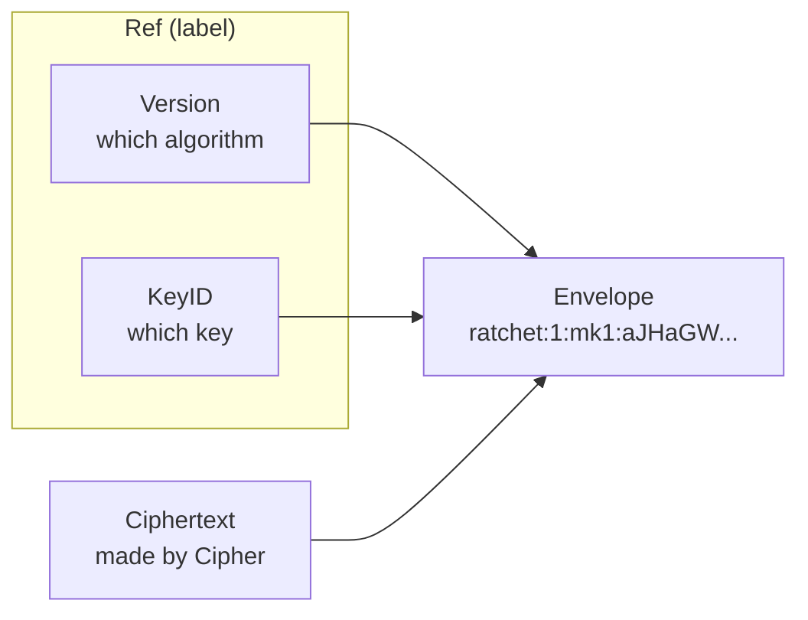
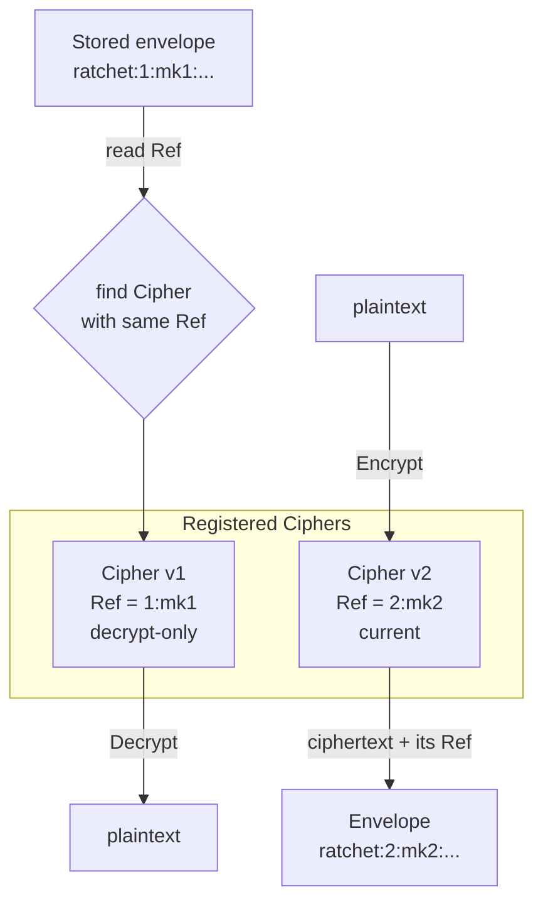

# ratchet

> Change algorithms and keys without rewriting your code or breaking stored data

Bring any algorithm, including the one already in production. ratchet only tracks which scheme
made each value and moves you to the next one: new values use your newest scheme, old values
stay usable. Like a ratchet gear, it only moves forward.

Supports encryption (AEAD) today via `ratchet/aead`. The core is algorithm-type agnostic, so
other types such as password hashing can plug in the same way.

```bash
go get github.com/riceball-tw/ratchet
```

Go 1.24+, standard library only.

## Example

```go
import (
    "github.com/riceball-tw/ratchet"
    "github.com/riceball-tw/ratchet/aead"
    "github.com/riceball-tw/ratchet/examples/aesgcm" // reference Cipher; copy it into your code
)

// ──────────────── Day 1: only v1 exists ────────────────
// Describe the scheme: version 1 of your algorithm, using the key named "master-key-2026".
schemeV1 := ratchet.Ref{Version: 1, KeyID: "master-key-2026"}
cipherV1, err := aesgcm.New(schemeV1, aes256Key) // aes256Key is 32 bytes from your KMS

// Build the ratchet. cipherV1 is the only scheme that encrypts new data.
encryptor, err := aead.New(aead.Config{Current: cipherV1})

// Associated data ties the ciphertext to one record, so it can't be copied to another row.
recordID := []byte("customers/42/tax_id")

// Encrypt, then store the envelope as a string.
envelope, err := encryptor.Encrypt([]byte("A123456789"), recordID)
storedValue := envelope.String() // "ratchet:1:master-key-2026:..."

// Later: parse the stored string and decrypt. The envelope says which scheme to use.
parsedEnvelope, err := ratchet.ParseEnvelope(storedValue)
plaintext, err := encryptor.Decrypt(parsedEnvelope, recordID)

// ──────────────── Months later: time to rotate the key or algorithm ────────────────
// Make cipherV2, and keep cipherV1 for reading only.
schemeV2 := ratchet.Ref{Version: 2, KeyID: "master-key-2027"}
cipherV2, err := aesgcm.New(schemeV2, newAES256Key)

encryptor, err = aead.New(aead.Config{
    Current:     cipherV2,                         // all new data uses v2
    DecryptOnly: []aead.Decrypter{cipherV1},       // old v1 data still readable
})

// The old v1 envelope still decrypts: its Ref says "use cipherV1".
plaintext, err = encryptor.Decrypt(parsedEnvelope, recordID)

// New writes are v2.
envelope, err = encryptor.Encrypt([]byte("A123456789"), recordID)
storedValue = envelope.String() // "ratchet:2:master-key-2027:..."
```

Error checks are left out for brevity; handle every `err` in real code.

`examples/aesgcm` is a reference `Cipher` to copy. ratchet itself ships no algorithm: bring
AES-GCM, ChaCha20, Tink, a KMS call, or a PQC hybrid.

## Envelope format

Every stored value says which scheme made it:

```text title="Ratchet Envelope Demo"
ratchet:1:mk1:aJHaGWyInGkfczT1HY3s3tNtyKU_mXRbKlyIRT1b0ogNjhc
│       │ │   └ base64url(ciphertext)
│       │ └ KeyID: which key
│       └ Version: which algorithm
└ Identifies data in the ratchet envelope format (no prefix means an Unversioned Ref)
```

An envelope is a **Ref** (which algorithm and key) plus the **ciphertext** a Cipher produced:



On decrypt, ratchet reads the Ref from the envelope and finds the Cipher registered with the
same Ref. That is how old and new schemes live side by side:



## Why

Crypto code gets written once, then a key leaks, an algorithm ages out, or nobody can say
which format a stored value is in. ratchet makes each of those a config change plus a backfill:

- **Know what made every value.** "Are we done migrating?" is `WHERE col LIKE 'ratchet:1:%'`.
- **Only one scheme writes.** Old schemes are decrypt-only; writing with them does not compile.
- **Start from what you have.** Wrap your existing decrypt function; untagged data still reads.

## Upgrading, in short

```go
// legacyDecrypter wraps the decrypt function you already have in production.
legacyDecrypter := aead.DecrypterFunc(ratchet.Unversioned, existingDecryptFunc)

// 1. Today: cipherV1 encrypts, untagged legacy data still decrypts.
aead.Config{Current: cipherV1, DecryptOnly: []aead.Decrypter{legacyDecrypter}}

// 2a. Deploy to every server: cipherV2 can decrypt, but nothing writes it yet.
aead.Config{Current: cipherV1, DecryptOnly: []aead.Decrypter{legacyDecrypter, cipherV2}}

// 2b. Then switch new writes to cipherV2. cipherV1 becomes decrypt-only.
aead.Config{Current: cipherV2, DecryptOnly: []aead.Decrypter{legacyDecrypter, cipherV1}}

// 3. Backfill: re-encrypt old rows with encryptor.Rewrap(envelope, recordID)
//    until no untagged or 'ratchet:1:%' rows remain.

// 4. Remove cipherV1 and the legacy decrypter.
aead.Config{Current: cipherV2}
```

> **Warning:** removing a scheme makes data still encrypted with it unreadable. Drop it only
> after the backfill finishes.

Full walkthrough, key-handling advice, and how to add your own algorithm: **[docs/GUIDE.md](docs/GUIDE.md)**.

## When not to use it

ratchet picks **which scheme** to use. It does not implement algorithms or manage keys.

- Starting fresh with no legacy data? [Tink](https://developers.google.com/tink) gives you
  algorithms, keysets and KMS integration out of the box.
- Want encryption as a service? [Vault Transit](https://developer.hashicorp.com/vault/docs/secrets/transit)
  uses the same versioned-ciphertext model with server-held keys.

ratchet fits when you **already have encrypted data in production** and need a disciplined
way to move it forward.

## License

MIT, see [LICENSE](LICENSE).
